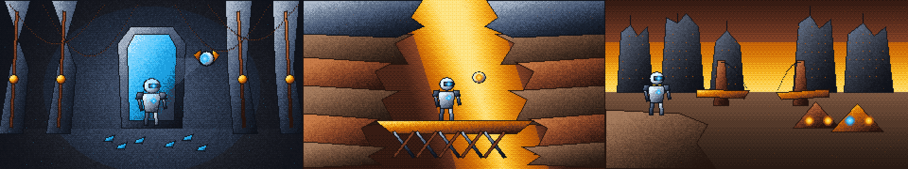

<div align="center">

# 🤖 CodeVerse: Debugger

**Game Edukasi Debugging Python 2D — Puzzle-Platformer & Top-Down Action-Puzzle RPG**


[](https://atongers.github.io/tugas-akhir_PPLG/)

> 🎮 **Mainkan Langsung di Browser (GitHub Pages):** [https://atongers.github.io/tugas-akhir_PPLG/](https://atongers.github.io/tugas-akhir_PPLG/) *(WebAssembly Single-Threaded, tanpa instalasi)*

*Kendalikan robot debugger **Dex** bersama pemandu AI **Lint** untuk memperbaiki baris kode Python yang rusak dan memulihkan dunia digital CodeVerse.*

<br/>


<br/>



</div>

---

## 📖 Daftar Isi
- [Untuk Pemain](#-untuk-pemain)
  - [Tentang Game & Sinopsis](#-tentang-game--sinopsis)
  - [Fitur Utama](#-fitur-utama)
  - [Daftar Dunia & Kurikulum](#-daftar-dunia--kurikulum)
  - [Kontrol Permainan](#-kontrol-permainan)
  - [Cara Bermain dari Source](#-cara-bermain-dari-source)
- [Untuk Kontributor](#-untuk-kontributor)
  - [Tech Stack & Spesifikasi](#-tech-stack--spesifikasi)
  - [Struktur Folder Proyek](#-struktur-folder-proyek)
  - [Menjalankan Automated Tests](#-menjalankan-automated-tests)
  - [Panduan Kontribusi](#-panduan-kontribusi)
- [Referensi Dokumentasi](#-referensi-dokumentasi)

---

# 🎮 Untuk Pemain

## 🧩 Tentang Game & Sinopsis

**CodeVerse: Debugger** adalah game edukasi *debugging* Python yang menggabungkan eksplorasi level dengan pemrograman langsung di dalam game. Ketika anomali korup **Glitch Overlord** melumpuhkan jaringan pusat CodeVerse, fasilitas bawah tanah **Lab Syntax Shore** mengaktifkan karantina otomatis dan mengunci seluruh gerbangnya.

AI pemandu **Lint** membangunkan **Dex**, robot debugger prototipe terakhir, untuk memperbaiki protokol Python yang rusak—mulai dari laser patroli, lift, dan crane di laboratorium karantina (*Dunia 1*), hingga berhasil naik ke permukaan kota pasca-bencana **Condition Canyon** (*Dunia 2*) untuk membantu warga penyintas di *Scrap Haven* dan memulihkan menara **The Gatekeeper AI**.

---

## ✨ Fitur Utama

- **Kode Adalah Dunia (*Bug Harus Terlihat*):** Kesalahan sintaks maupun logika kode Python langsung berwujud perilaku mesin yang kacau di level—laser menembak membabi buta, lift berhenti di tempat salah, crane berjalan mundur, hingga turret IFF salah memfilter warga.
- **Gagal Itu Aman:** Tanpa nyawa terbatas atau *Game Over* permanen. Jika `HP` habis (`0/100`) atau jatuh ke jurang, Dex langsung respawn di *checkpoint* (`CapsulePod` / `BeaconPad`) dengan `HP` & `Energy` penuh **tanpa menghapus progres kode, item, maupun quest**.
- **Mini-Interpreter Python Berbahasa Indonesia:** Mendukung variabel, operasi aritmetika (`+`, `-`, `*`, `/`, `//`, `%`), fungsi `print()`, `int()`, `str()`, `abs()`, `len()`, serta blok kondisional bersarang `if / elif / else` dengan operator perbandingan dan logika boolean (`and`, `or`, `not`). Pesan error tampil dalam Bahasa Indonesia ramah pemula sambil mempertahankan istilah asli Python.
- **Alat Debugging Bertahap & Hint 3 Tingkat:** Dilengkapi *Output Console*, tombol *Quick-Insert `print()`*, sorotan eksekusi *Step-by-Step* (`1x`, `2x`, `Skip`), tombol `Reset` aman, **Bug Log (`BUG-01` s/d `BUG-16`)**, serta 3 tingkat petunjuk dari Lint (`[F1]`).
- **RPG Crafting, Ekonomi & Upgrade Tree (Dunia 2):** Hadapi musuh AI (*Scrap Hound*, *Patrol Drone*, *Shield Sentinel*) memakai **Tactical EMP Pulse**, rakit peralatan lewat **Dual-Layer Workbench** (termasuk teka-teki *Logic Calibration* yang tidak menghanguskan bahan saat kode gagal), investasikan *Scrap Bits* ke **12-Node Upgrade Tree**, selesaikan **Main & Side Quest**, serta koleksi **12 RPG Achievement Badges**.
- **Sistem Audio Dinamis V2.1:** Soundtrack khusus per dunia (*Synthwave/Chiptune* & *Dusty Post-Apocalyptic*), *ambience* lingkungan, efek suara interaktif, serta *auto-ducking* volume musik secara halus saat membuka editor terminal atau berdialog.

---

## 🌍 Daftar Dunia & Kurikulum

| Dunia | Genre & Arena | Konsep Python yang Dipelajari | Fitur & Tantangan Utama | Status |
| :--- | :--- | :--- | :--- | :---: |
| **Dunia 1: Syntax Shore** | *Side-Scrolling Puzzle-Platformer 2D* (`Level 1–3`) | Variabel, tipe data, `NameError`, `TypeError`, PEMDAS `(...)`, modulo `%`, *variable overwrite*, `//`, `abs()`, `str()`, & `print()` | `14` Code Terminal, *cover* di balik `CompanionCrate`, *Reprogram-to-Traverse* di *Dual-Deck Arena*, & *Low-Power Corridor*. | **Tersedia** |
| **Dunia 2: Condition Canyon** | *Seamless Top-Down Action-Puzzle RPG* (`5 Distrik`, akses `Act 1–3`) | Blok indentasi `if / elif / else` bersarang, perbandingan (`==`, `!=`, `<`, `>`, `<=`, `>=`), logika boolean (`and`, `or`, `not`), & *Shadowed Branch* | Cutscene transisi 3-slide, `5` Terminal + `3` Kalibrasi Workbench, `3` Friendly NPC, `6` Quest (`MQ`/`SQ`), `3` Lore Logs, & Boss 2-Tahap **Gatekeeper AI**. | **Tersedia** |
| **Dunia 3: Loop Labyrinth** | *Roadmap* | Perulangan `for`, `while`, `range()` + alat **Step Trace** | Menanti di gerbang setelah Boss Dunia 2 pulih. | *Segera Hadir* |
| **Dunia 4: Function Foundry** | *Roadmap* | `def`, parameter, `return`, *scope* + alat **Watch Variabel** | — | *Segera Hadir* |
| **Dunia 5: List Citadel** | *Roadmap* | `list`, *indexing*, manipulasi struktur data + **Breakpoint** & **Glitch Overlord** | — | *Segera Hadir* |

---

## 🕹️ Kontrol Permainan

| Aksi | Keyboard | Mouse | Gamepad *(Parsial)* |
| :--- | :--- | :--- | :--- |
| **Gerak Kiri / Kanan** | `A` / `D` atau `←` / `→` | — | Stick Kiri / D-Pad |
| **Gerak Atas / Bawah *(Dunia 2)*** | `W` / `S` atau `↑` / `↓` | — | Stick Kiri / D-Pad |
| **Lompat *(Dunia 1)*** | `Spasi` | — | `A` / Cross |
| **Tactical EMP Pulse *(Dunia 2)*** | `F` atau `Spasi` | Klik Kiri di area arena | — |
| **Sprint** | `Shift` *(tahan sambil bergerak)* | — | Button `L3` |
| **Interaksi *(Terminal / NPC / Workbench)*** | `E` | Klik tombol HUD terkait | `X` / Square |
| **Quick-Use Item *(Dunia 2)*** | `1` (*Repair Patch +50 HP*), `2` (*Battery +50 EN*) | Klik tombol `[1]` / `[2]` di Action Bar | — |
| **Kamera Overview *(Zoom Out Peta)*** | `Tab` | — | Select / View |
| **Shortcut Modal & Log** | `J` (*Quest & Lore*), `U` (*Upgrade Tree*), `L` (*Bug Log*) | Klik tombol di HUD / Main Menu | `Y` / Start |
| **Di Dalam Terminal / Workbench** | `Ctrl+Enter` (*Run*), `Ctrl+R` (*Reset*), `F1` (*Hint*), `Esc` (*Tutup*) | Klik tombol & kursor teks | `B` / Circle (*Tutup*) |

---

## ▶️ Cara Bermain dari Source

1. Unduh dan pasang **Godot Engine `4.7.2-stable`** (versi *Standard*, bukan .NET).
2. Clone repository ini:
   ```bash
   git clone https://github.com/Atongers/tugas-akhir_PPLG.git
   cd tugas-akhir_PPLG
   ```
3. Buka **Godot Project Manager**, klik **Import**, lalu arahkan ke file `project.godot`.
4. Klik **Run Project (`F5`)** — game akan langsung terbuka pada `res://scenes/ui/menus/main_menu.tscn`.
   - Progres pemain (*skin*, level selesai, `Scrap Bits`, item *crafting*, *upgrade*, *quest*, *Bug Log*, dan *Achievements*) tersimpan lokal di `user://save_data.json`.
   - Pengaturan audio dan layar penuh tersimpan di `user://settings.cfg`.

---

# 🛠️ Untuk Kontributor

Kontribusi kode, desain level, aset pixel-art, audio, maupun perbaikan bug sangat terbuka! Sebelum melakukan perubahan, pahami standar teknis proyek di bawah ini.

## ⚙️ Tech Stack & Spesifikasi

- **Engine:** Godot Engine `4.7.2-stable` (`Forward Plus` 2D Renderer)
- **Bahasa Engine:** `GDScript 2.0` (*static typing*)
- **Resolusi Base:** `1152 × 648 px` (`canvas_items` stretch mode, `expand` aspect, `TEXTURE_FILTER_NEAREST`)
- **Autoload Singletons (`project.godot`):**
  - `SaveManager` (`scripts/autoload/save_manager.gd`) — persistensi progres V2 lintas Dunia 1 & Dunia 2.
  - `AudioManager` (`scripts/autoload/audio_manager.gd`) — hierarki bus (`Master` → `BGMDuck` → `BGM`/`Ambience`, `Master` → `SFX` → `UI`), kurva dB kuadrat, *crossfade*, *auto-ducking*, dan *randomizer pool*.
  - `PythonInterpreter` (`scripts/interpreter/python_interpreter.gd`) — parser & evaluator subset Python + penerjemah error Bahasa Indonesia.

---

## 📁 Struktur Folder Proyek

Untuk panduan struktur lengkap, lihat [STRUCTURE.md](STRUCTURE.md). Ringkasan direktori utama:

```text
├── assets/
│   ├── audio/              # 7 BGM/Ambience (.ogg -24 LUFS) & 52 SFX/Stingers (.wav 44.1 kHz)
│   ├── fonts/              # JetBrainsMono (Bold, SemiBold, Regular)
│   ├── sprites/            # Sprite karakter, objek & VFX Dunia 1
│   ├── tilesets/           # Tileset Lab Syntax Shore
│   ├── ui/                 # Ikon tool dock, gembok, lencana dunia & UI rework 9-slice
│   ├── world_2/            # 24 paket aset pixel-art 32-bit Condition Canyon (48×48, 64×64, 96×96)
│   └── asset-manifest.json # Sumber kebenaran metadata, dimensi & lisensi seluruh aset
├── documentation/          # Laporan Alpha Testing & verifikasi Audio V2.1
├── GDD/                    # Dokumen Game Design (Master FIX .docx, Issues, Brief & Reports)
├── scenes/                 # Scene Godot (.tscn): main menu, characters, & levels World 1–2
├── scripts/
│   ├── autoload/           # SaveManager & AudioManager
│   ├── characters/         # DexController (W1), DexTopDownController (W2), FriendlyNPC, EnemyTopDown
│   ├── interpreter/        # Mini PythonInterpreter
│   ├── levels/             # Level builders (World 1 Lv.1–3, World 2 City Builder & World2Data)
│   ├── objects/            # CodeTerminal, CapsulePod, Hazard, Programmable objects & BossGatekeeperAI
│   └── ui/                 # TerminalOverlay, WorkbenchOverlay, UpgradeTree, QuestJournal, HUD & MainMenu
└── tests/                  # Automated test suites (test_world_2.gd & test_audio_system.gd)
```

---

## 🧪 Menjalankan Automated Tests

Proyek menyediakan dua *test suite* berbasis `McpTestSuite` untuk memverifikasi *zero regression* sebelum membuka Pull Request:

1. [`tests/test_world_2.gd`](tests/test_world_2.gd) (`suite_name = "world_2"`):
   - Menguji kompatibilitas `PythonInterpreter` pada skrip Dunia 1, dukungan `if/elif/else` & deteksi `BUG-11..13`, persistensi `SaveManager` V2, serta instansiasi peta `world_2_city.tscn` (`Act 1–3`) beserta penghalang progresi.
2. [`tests/test_audio_system.gd`](tests/test_audio_system.gd) (`suite_name = "audio_system"`):
   - Menguji topologi bus `AudioServer`, kurva volume kuadrat (`pct_to_db`), keberadaan ke-59 aset audio di `assets/asset-manifest.json`, *crossfade* BGM/Ambience, *auto-ducking*, dan manajemen loop SFX.

> Pastikan seluruh test berstatus `PASS` dengan **0 runtime/script error** di tab Output/Log Godot sebelum melakukan *merge*.

---

## 🤝 Panduan Kontribusi

1. **Cek Issues Terlebih Dahulu:** Lihat daftar issue terbuka di tab [GitHub Issues](https://github.com/Atongers/tugas-akhir_PPLG/issues) atau diskusikan fitur/bug baru sebelum mulai coding.
2. **Branching:** Buat branch baru dari `main` dengan penamaan deskriptif (contoh: `feat/world-3-loops`, `fix/terminal-indent`, `audio-feature`). Jangan langsung *push* ke `main`.
3. **Konvensi Kode & Desain:**
   - Tulis kode, identifier, komentar, dan pesan *commit* (*Conventional Commits*, mis. `feat(world-2): ...`, `fix(ui): ...`) dalam **Bahasa Inggris**, sementara teks antarmuka pemain dan pesan error interpreter tetap **Bahasa Indonesia** yang ramah pemula.
   - Pastikan seluruh skrip `@tool` menjaga guard `Engine.is_editor_hint()` agar tidak menjalankan logika runtime/audio di editor.
   - Jangan memecah atau merusak progresi level **Dunia 1** saat menambah fitur baru.
4. **Penambahan Aset Baru (Visual / Audio):**
   - Simpan aset ke subfolder `assets/` yang sesuai dengan penamaan `snake_case`.
   - **Jangan** mengedit file `.import` atau `.uid` secara manual (biarkan Godot Editor menghasilkan ulang).
   - Wajib mendaftarkan aset baru (ukuran/durasi, format, lisensi/sumber, dan hasil cek teknis) ke [`assets/asset-manifest.json`](assets/asset-manifest.json).
5. **Pull Request:** Sertakan ringkasan perubahan, referensi nomor issue (`Closes #<nomor>`), dan bukti lulus uji `test_world_2` / `test_audio_system` saat mengajukan Pull Request.

---

## 📚 Referensi Dokumentasi

- **GDD Master Konsolidasi (FIX):** [`GDD/GDD-FIX/game-design-document.docx`](GDD/GDD-FIX/game-design-document.docx)
- **Rangkuman Kondisi Build V2.0:** [`documentation/gdd-summary-V2.0.md`](documentation/gdd-summary-V2.0.md)
- **Laporan Alpha Testing V2.0:** [`documentation/alpha-testing/alpha-testing-V2.0.md`](documentation/alpha-testing/alpha-testing-V2.0.md)
- **Laporan Verifikasi Audio V2.1:** [`documentation/audio-verification-V2.1.md`](documentation/audio-verification-V2.1.md)
- **Panduan Struktur Proyek:** [`STRUCTURE.md`](STRUCTURE.md)
