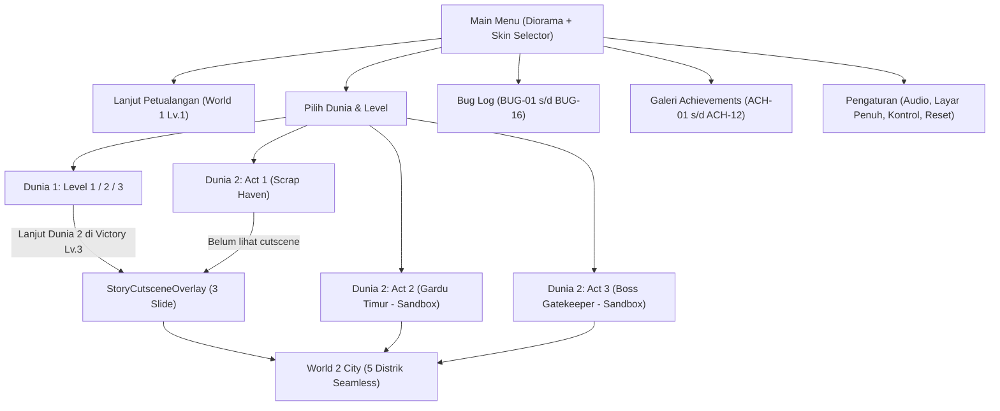
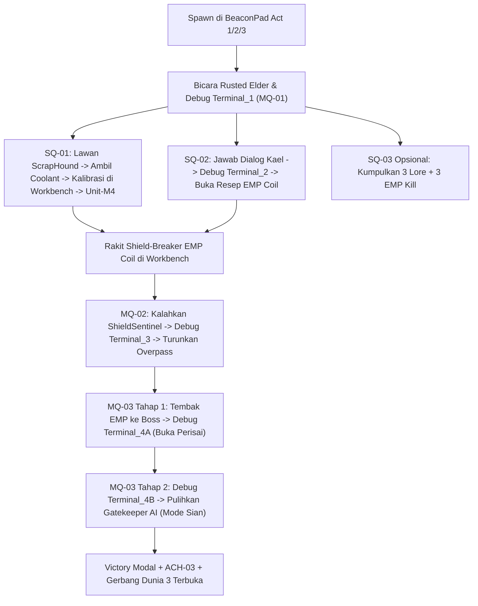

# GAME DESIGN DOCUMENT (GDD) — RANGKUMAN KONDISI AKTUAL BUILD V2.0

> **Catatan untuk Game Designer:** Dokumen ini mengikuti struktur [`GDD/GDD-TEMPLATE/Game-Design-Document-Template.pdf`](file:///c:/Users/Fathan%20Ridho%20Wahyudi/Documents/tugas-akhir_PPLG/GDD/GDD-TEMPLATE/Game-Design-Document-Template.pdf) dan mendokumentasikan **perilaku serta fitur yang benar-benar terjadi dan terimplementasi pada build V2.0 saat ini** (hasil Alpha Testing V2.0), sebagai bahan penyelarasan dan pendetailan desain selanjutnya.

---

# CodeVerse: Debugger

**CodeVerse: Debugger** adalah game puzzle edukasi pemrograman Python di mana pemain mengendalikan unit robot debugger bernama **Dex** (didampingi AI pemandu **Lint**) untuk memperbaiki kode Python yang rusak pada terminal dunia digital yang mengalami anomali.

## Genre:
Puzzle-Platformer 2D (Dunia 1) & Top-Down Action-Puzzle RPG 2D (Dunia 2) bertema edukasi debugging Python.

## Game Elements:
- Eksplorasi dua gaya level: *Side-Scrolling Platformer* 2D di **Dunia 1: Syntax Shore** (3 level) dan *Seamless Top-Down City* 5 distrik di **Dunia 2: Condition Canyon** (1 peta kota terpadu dengan 3 Act checkpoint).
- Membaca, mengedit, dan menjalankan skrip Python in-game pada **Terminal Kode** untuk memanipulasi objek dunia (laser, elevator, crane, scanner, gerbang kota, turret IFF, jembatan overpass, dan perisai boss).
- Menyaksikan eksekusi kode langkah demi langkah (*step-by-step highlight*), melihat status variabel (*Watch Panel*), output `print()`, dan pesan error Bahasa Indonesia ramah pemula.
- Sistem **Quest (3 Main Quest & 3 Side Quest)**, dialog RPG bercabang dengan 3 NPC penyintas, serta pencarian **3 Lore Data Log**.
- Pertempuran taktis **Tactical EMP Pulse**, pengumpulan loot material & mata uang **Scrap Bits**, perakitan item **Dual-Layer Workbench** (Instan & *Logic Calibration* berbasiskan Python), **12-Node Firmware Upgrade Tree**, dan **12 RPG Achievements**.

## Player:
Single-player, offline (progres tersimpan lokal ke `user://save_data.json`).

---

# TECHNICAL SPECS

## Technical Form:
2D Pixel-Art (`TEXTURE_FILTER_NEAREST`, grid dasar `16×16 px`, karakter platformer `32×32 px`, karakter top-down `48×48 px`, boss `96×96 px`, UI 9-slice pixel-tech).

## View:
- **Main Menu:** Diorama paralaks 4-lapis dengan panel Skin Selector di kanan bawah dan modal pop-up di tengah.
- **Dunia 1 (Syntax Shore):** Tampilan samping (*side view*) 2D dengan kamera mengikuti Dex dan mode zoom-out `[Tab]` untuk melihat keseluruhan peta level.
- **Dunia 2 (Condition Canyon):** Tampilan atas-miring (*top-down 2D*, `y_sort_enabled`) dengan kamera `zoom = 1.5` dan mode *Overview Map* `[Tab]` (`zoom = 0.55`) untuk memantau 5 distrik sekaligus (`1920 × 1280 px`).

## Platform:
PC (Desktop — Windows). Resolusi dasar viewport `1152 × 648` (`canvas_items` stretch, `expand`).

## Language:
Dibuat menggunakan **Godot Engine `4.7.2-stable`** dengan **GDScript 2.0** (*static typing*). Bahasa pemrograman di dalam permainan adalah **subset Python** yang dijalankan oleh `PythonInterpreter` internal (variabel, aritmetika, `print/int/str/abs/len`, serta blok `if/elif/else` bersarang dengan operator perbandingan dan logika boolean).

## Device:
PC (Keyboard + Mouse sebagai kontrol utama; dukungan Gamepad parsial untuk aksi gerak/lompat/interaksi dasar).

---

# GAME PLAY

Saat aplikasi dibuka, pemain disambut oleh Main Menu interaktif yang menampilkan Dex dan Lint di ruang laboratorium sambil memilih skin unit (*Cyan Debugger*, *Volt Scout*, atau *Plasma Sentinel*) serta membuka menu Level, Bug Log, Achievements, atau Pengaturan. Di **Dunia 1 (Syntax Shore)**, Dex bergerak dan melompat melewati rintangan laser dan duri untuk mendekati terminal kode yang rusak, lalu menekan `E` untuk membuka *Terminal Overlay*. Pemain mengamati kode yang error (misalnya typo `prin()`, penjumlahan teks `"60" + 40`, salah operator `+` menjadi `-`, atau rumus PEMDAS/modulo), memperbaiki baris kode yang tidak terkunci, dan menekan `Run`. Setiap langkah kode disorot kuning/merah secara visual dan langsung menonaktifkan laser, menggerakkan lift, atau membuka gerbang Exit menuju level berikutnya.

Setelah menamatkan Level 3 atau memilih langsung **Dunia 2: Condition Canyon** di menu Pilih Dunia, pemain disambut cutscene prolog 3-slide sebelum menjejakkan kaki di permukaan ngarai **Condition Canyon** dengan kontrol top-down 8-arah. Di sini permainan berkembang menjadi petualangan RPG taktis tanpa layar loading antar-distrik: pemain berbicara dengan **Rusted Elder**, **Kael Scrapwright**, dan **Unit-M4 Medic** di pos *Scrap Haven*, membasmi *Scrap Hound*, *Patrol Drone*, dan *Shield Sentinel* menggunakan gelombang *Tactical EMP Pulse*, mengumpulkan *Scrap Bits* dan komponen rongsokan, mengkalibrasi resep item melalui teka-teki `if/elif/else` di **Workbench**, membeli 12 modul peningkatan di **Upgrade Tree**, hingga meruntuhkan perisai dan memulihkan inti logika **Boss The Gatekeeper AI** menjadi mode pelindung sian.

## Game Play Outline
- **Opening the game application:** Layar utama menampilkan judul *CodeVerse: Debugger*, tombol navigasi vertikal di kiri, diorama paralaks di kanan, dan *Unit Skin Selector*.
- **Game options:** Menu *Pengaturan* berisi slider volume Audio (`Master`, `BGM`, `SFX`), toggle `Layar Penuh`, panduan visual *keycap* kontrol keyboard, serta tombol `Reset Progres Reward` dengan konfirmasi ganda.
- **Story synopsis:** Anomali *Glitch Overlord* melumpuhkan jaringan pusat CodeVerse. Di Dunia 1, Dex lolos dari karantina Lab *Syntax Shore*. Di Dunia 2, Dex naik ke permukaan kota penyortiran energi *Condition Canyon* untuk memulihkan gerbang kota, membantu penyintas *Scrap Haven*, dan menyembuhkan *Gatekeeper AI*.
- **Modes:**
  - *Mode Campaign / Progression:* Dimainkan berurutan dari Dunia 1 (Level 1 → Level 2 → Level 3) berlanjut ke Dunia 2 (*Act 1*).
  - *Mode Checkpoint Playtest (Act 1 / Act 2 / Act 3):* Akses langsung di Main Menu ke *Act 1: Scrap Haven*, *Act 2: Gardu Timur*, atau *Act 3: Boss Gatekeeper* (Act 2 & 3 berjalan dalam *in-memory sandbox* lengkap dengan quest prasyarat & item `Shield-Breaker EMP Coil`).
- **Game elements:** Terminal Kode (`CodeTerminal`), Platform Lift & Crane (`World 1`), Rintangan Laser & Floor Spike, NPC Quest & Dialog Bercabang (`World 2`), Workbench Dual-Layer, 12-Node Upgrade Tree, Musuh AI Top-Down, Lore Data Logs, dan Boss Gatekeeper AI 2-Tahap.
- **Game levels:**
  - *Dunia 1 (`Syntax Shore`):* Level 1 (4 terminal — `NameError`, `TypeError`, aritmetika), Level 2 (5 terminal — `PEMDAS`, `%`, overwrite), Level 3 (5 terminal — dual-deck `//`, `abs()`, `str()`).
  - *Dunia 2 (`Condition Canyon`):* 1 peta kota terpadu berisi 5 distrik (*Outskirts Bunker Exit*, *Scrap Haven Safe Hub*, *Scrapyard Barat-Utara*, *Power Sub-Station Timur*, *Canyon Overpass & Boss Arena*) dengan 5 terminal utama (`Terminal_1`, `Terminal_2`, `Terminal_3`, `Terminal_4A`, `Terminal_4B`) dan 3 resep kalibrasi Workbench.
- **Player's controls:** Lihat bagian *User Interface (UI)*.
- **Winning:**
  - *Dunia 1:* Semua terminal level diperbaiki dan Dex mencapai `ExitGate` yang terbuka → tampil modal *Level Complete* + hadiah skin/tool/Bug Log + tombol lanjut ke level/dunia berikutnya.
  - *Dunia 2:* Menyelesaikan 2 tahap Boss `Gatekeeper AI` (`Terminal_4A` untuk membuka perisai + `Terminal_4B` untuk memulihkan `"MODE_PELINDUNG_SIAN"`) → Boss berubah ke mode Sian, quest `MQ-03` & badge `ACH-03` terbuka, dan modal kemenangan Dunia 2 tampil.
- **Losing:**
  - Tidak ada *Game Over* permanen. Saat terkena bahaya (laser, duri, atau serangan musuh) hingga `HP = 0`, Dex mengalami animasi tumbang/collapse singkat lalu **respawn otomatis** di *BeaconPad* / checkpoint terakhir dengan `HP` dan `EN` penuh tanpa kehilangan progres kode maupun item.
- **End:** Terbukanya gerbang transisi menuju **Dunia 3: Loop Labyrinth** (saat ini masih dalam tahap perencanaan/terkunci di Build V2.0).
- **Why is all this fun?** Pemain belajar logika pemrograman Python secara langsung melalui sebab-akibat visual di level, diperkuat oleh kepuasan progresi RPG (upgrade skill, merakit peralatan dengan kode, dan memulihkan dunia yang korup).

## Key Features
1. **Mini-Interpreter Python In-Game & Visual Execution:** Eksekusi bertahap (`1x`, `2x`, `Skip`), highlight baris aktif, watch variabel real-time, pesan error Bahasa Indonesia (`BUG-01` s/d `BUG-16`), serta 3 tingkat *Hint* Lint.
2. **Kurikulum Bertingkat Tanpa Regresi:** Variabel/Aritmetika di Dunia 1 berkembang ke Percabangan `if/elif/else`, Perbandingan, Indentasi, dan Operator Boolean (`and`/`or`/`not`) di Dunia 2.
3. **Dual-Layer Crafting (`WorkbenchOverlay`):** Perakitan cepat item konsumsi (`Repair Patch`, `Battery Cell`) dan *Logic-Calibrated Crafting* di mana bahan tidak hangus jika skrip Python pengguna masih salah.
4. **Sistem Progresi Terhubung:** `SaveManager` menyimpan progres lintas sesi meliputi skin karakter, Debug Tool Dock (`Quick-Insert print()`, `Speed 2x/Skip`), 16 entri Bug Log, 12 Upgrade Tree, 6 Quest, 3 Lore, dan 12 Achievement Badges.

---

# DESIGN DOCUMENT

## Design Guidelines
1. **Kode Adalah Dunia:** Perubahan pada kode di Terminal/Workbench langsung menghasilkan efek nyata di arena (membuka gerbang, memutus perisai boss, atau merakit alat penembus perisai).
2. **Aman Bereksperimen:** Respawn instan di checkpoint, tombol Reset Kode pada setiap terminal, regenerasi Energy pasif yang tetap berjalan saat terminal dibuka, serta proteksi bahan Workbench jika kode masih gagal.
3. **Zero Regresi & Modularitas:** Sistem Dunia 1 dan Dunia 2 berbagi `SaveManager`, `PythonInterpreter`, `TerminalOverlay`, dan `HudTopBar`, sementara kontroler karakter (`DexController` vs `DexTopDownController`) terpisah sesuai kebutuhan genre level.
4. **Kejelasan Pixel-Tech UI:** Seluruh antarmuka memakai font monospace (`JetBrainsMono`) dan aset pixel `TEXTURE_FILTER_NEAREST` agar teks kode tetap tajam pada skala desktop.

## Game Design Definitions

| Elemen / GameObject | Perilaku Aktual di Build V2.0 | Kontrol / Pemicu | Properti Utama |
| :--- | :--- | :--- | :--- |
| **Dex (`DexController` — W1)** | Berjalan, sprint, melompat (*coyote time* & *jump buffer*), kena damage dari laser/duri/plasma. | `A/D` (`Arrow`), `Spasi`, `Shift`, `E` | `HP: 100`, `EN: 100`, respawn di `CapsulePod`. |
| **Dex (`DexTopDownController` — W2)** | Bergerak 8-arah bebas, sprint, menembakkan gelombang *EMP Pulse* di sekitar diri, pakai item cepat. | `W/A/S/D`, `Shift`, `F`/`Spasi`/`Klik Kiri`, `[1]`, `[2]`, `E` | `HP: 100 (+25)`, `EN: 100 (+25)`, `EMP Radius: 56 px (+35%)`, `EMP Dmg: 25 (+50%/+15%)`. |
| **Code Terminal** | Membuka `TerminalOverlay` berisi skrip Python level dengan baris terkunci (*gutter icon*). | Dekati radius interaksi (`28–44 px`), tekan `E` | Membutuhkan `10 EN` (`5 EN` dengan `util_3`) untuk `Run`; mendukung `1x`, `2x`, `Skip`, `+ print()`, `Hint 1..3`. |
| **ScrapHound (`EnemyTopDown`)** | Patroli di *Scrapyard*; mengejar dalam radius `115 px` dan menerjang (*lunge*) saat dekat. | AI otomatis; diserang dengan `EMP Pulse` | `HP: 45`, `Speed: 72 px/s`, `Dmg: 15`, Drop: `+15 Bits`, `Coolant Cell`, `Scrap Metal`. |
| **PatrolDrone (`EnemyTopDown`)** | Melayang di *Power Sub-Station*; menembakkan bola energi (`120 px/s`, `15 dmg`) tiap `2.2 detik` yang dapat dihindari pemain dalam radius `125 px`, dilengkapi *soft separation* agar tidak menumpuk. | AI otomatis; diserang dengan `EMP Pulse` | `HP: 60`, `Speed: 60 px/s`, `Dmg: 15`, Drop: `+20 Bits`, `Copper Wire`, `Logic Core`. |
| **ShieldSentinel (`EnemyTopDown`)** | Menjaga *Gardu Timur* (`Row 0` Guard Walk saat patroli, `Row 1` Shield Active saat mengejar); kebal EMP Tier 1, perisai runtuh `5 detik` jika terkena EMP Tier 2 (`Shield-Breaker EMP Coil`), menjadi gerbang wajib sebelum `Terminal_3`. | AI otomatis; butuh `Shield-Breaker EMP Coil` | `HP: 90`, `Speed: 46 px/s`, `Dmg: 20`, Drop: `+45 Bits`, `2× Logic Core`, `Glitch Shard`. |
| **Boss Gatekeeper AI** | Pertarungan 2 tahap: Tahap 1 perisai merah aktif & menembakkan bola laser plasma (`12 dmg`, dapat dihindari) tiap `3 detik`; setelah ditembak EMP, `Terminal_4A` terbuka; setelah solved masuk Tahap 2 Overheat (`Terminal_4B`) hingga pulih ke mode Sian. | EMP membuka `Terminal_4A` → debug `Terminal_4A` → debug `Terminal_4B` | 3 fase visual (`Row 0 Red`, `Row 1 Amber`, `Row 2 Restored Cyan`). |
| **Friendly NPCs (3 Unit)** | *Rusted Elder*, *Kael Scrapwright* (dengan teka-teki pilihan ganda logika IFF), dan *Unit-M4 Medic* (penerima item *Coolant Stabilizer*). | Tekan `E` dekat NPC; emote `!` / `...` / `?` | Membuka quest & dialog RPG 9-slice + potret `48×48`. |
| **Workbench Station** | Merakit 3 resep instan & 3 resep kalibrasi kode Python. | Tekan `E` di meja atau tombol HUD `Workbench` | Memvalidasi bahan & eksekusi `rakit_item(...)`. |
| **Upgrade Tree Graph** | Membeli hingga 12 peningkatan pasif di 3 cabang (*Survival*, *Tactical*, *Utility*) memakai `Scrap Bits`. | Tekan `[U]` atau tombol HUD `[U] Upgrade` | Syarat parent-node berurutan (`25–65 Bits` per node). |

## Game Flowchart

### Alur Utama Aplikasi (Build V2.0)

### Alur Gameplay World 2: Condition Canyon

## Player Definition

### Player Definitions
- **Health (`HP`):** `100` dasar (`125` dengan `surv_1`); berkurang saat terkena laser, duri, atau serangan musuh (`-20%` damage dengan `surv_2`).
- **Energy (`EN`):** `100` dasar (`125` dengan `surv_3`); beregenerasi otomatis (`12/detik`, `+50%` dengan `surv_4`). Digunakan untuk Sprint (`20 EN/detik`), menembak `EMP Pulse` (`15 EN`, atau `10 EN` dengan `emp_3`), dan mengeksekusi kode di Terminal (`10 EN`, atau `5 EN` dengan `util_3`).
- **Weapons / Tactical Tools:** Di Dunia 1 tanpa senjata; di Dunia 2 memakai gelombang **Tactical EMP Pulse** (area radius `56 px` — `75.6 px` dengan `emp_1`, stun `0.6s` / `1.5s` dengan `emp_4`).
- **Actions:** Gerak 2D (Side-View / Top-Down 8-Arah), Lompat (W1), Sprint, Interaksi `[E]`, EMP Pulse (W2), Quick-Use Item `[1]/[2]`, serta navigasi modal HUD.

### Player Properties & Feedback

| Properti | Nilai Aktual | Umpan Balik (*Feedback*) saat Berubah |
| :--- | :--- | :--- |
| **Health (`HP`)** | `0..100` (atau `125`) | Bar hijau di `HudTopBar` berubah menjadi bar kritis merah + ikon peringatan `!` saat `HP <= 30`; sprite Dex berkedip merah + knockback saat terkena hit; animasi berlutut/rebah (`Collapse`) saat `HP = 0` sebelum respawn. |
| **Energy (`EN`)** | `0..100` (atau `125`) | Bar biru cyan di `HudTopBar` berubah warna amber saat `EN <= 20`; teks angka `cur/max` diperbarui real-time. |
| **Active Skin** | `default`, `volt_scout`, `plasma_sentinel` | Penampilan sprite Dex di Main Menu, Dunia 1, dan sprite Top-Down `48×48` di Dunia 2 langsung berganti sesuai skin terpilih. |
| **Scrap Bits** | `0..∞` | Angka saldo koin di bilah aksi bawah World 2 & modal Upgrade Tree/Workbench bertambah; otomatis membuka `ACH-09` saat total akumulasi `>= 200 Bits`. |

### Player Rewards (Power-ups, Pick-ups, & Progression Unlocks)
- **Loot Musuh & Map (Dunia 2):** `Scrap Bits`, `Scrap Metal`, `Copper Wire`, `Logic Core`, `Coolant Cell`, `Glitch Shard`, dan `3× Lore Data Log` (ditambah bonus `+5 Bits` & jangkauan tarik lewat upgrade `util_1`).
- **Consumables & Equipment:** `Repair Patch` (`+50 HP`), `Battery Cell` (`+50 EN`), `EMP Charge Overclock` (`Full EN + reset cooldown`), `Coolant Stabilizer` (Quest `SQ-01`), `Shield-Breaker EMP Coil` (EMP Tier 2 penembus perisai Sentinel), `Logic Calibrator Lens` (`+15%` EMP damage).
- **12 Upgrade Tree Nodes:** Peningkatan permanen stat *Survival* (`surv_1..4`), *Tactical EMP* (`emp_1..4`), dan *Utility* (`util_1..4`).
- **Meta-Rewards:** `Quick-Insert print()` & `Volt Scout` (tamat W1 Lv.2), `Speed 2x/Skip` & `Plasma Sentinel` (tamat W1 Lv.3), `BUG-01` s/d `BUG-16`, dan `12 RPG Achievement Badges` (`ACH-01..12`) dengan notifikasi Toast.

## User Interface (UI)

### Peta Kontrol Pemain

| Aksi | Input Keyboard / Mouse Aktual | Keterangan |
| :--- | :--- | :--- |
| **Gerak Kiri / Kanan** | `A / D` atau `Panah Kiri / Kanan` | Dunia 1 (horizontal) & Dunia 2 (top-down) |
| **Gerak Atas / Bawah** | `W / S` atau `Panah Atas / Bawah` | Dunia 2 (top-down 8-arah) |
| **Lompat / EMP Pulse** | `Spasi` (Lompat di W1) / `F`, `Spasi`, `Klik Kiri` (EMP di W2) | EMP otomatis diblokir saat modal UI terbuka |
| **Sprint** | `Shift` (tahan sambil bergerak) | Mengonsumsi Energy |
| **Interaksi Objek / NPC / Terminal** | `E` | Membuka Terminal, Dialog NPC, Workbench, atau Upgrade |
| **Quick-Use Item (W2)** | `1` (*Repair Patch*), `2` (*Battery Cell*) | Juga dapat diklik langsung di bilah aksi bawah |
| **Kamera Overview** | `Tab` | Toggle zoom-out penuh arena/kota vs kamera mengikuti Dex |
| **Modal Pintasan (W2 & HUD)** | `J` (Jurnal Misi & Lore), `U` (Upgrade Tree), `L` (Bug Log) | Juga tersedia sebagai tombol klik di `HudTopBar` / `World2ActionBar` |
| **Shortcut di Dalam Terminal** | `Ctrl+Enter` (Run), `Ctrl+R` (Reset), `F1` (Hint), `Esc` (Tutup) | Berlaku di `TerminalOverlay` dan `WorkbenchOverlay` (`Ctrl+Enter`/`Esc`) |

### Struktur Tata Letak HUD In-Game
- **Top Bar (`HudTopBar`):** Berisi *Vitality Frame* (HP & EN bar + angka), *Quest Tracker Card* (teks misi aktif dengan `OVERRUN_TRIM_ELLIPSIS` + progres jumlah terminal + `[Tab]`), tombol `Bug Log [L]`, dan tombol `Menu Utama` (membuka popup konfirmasi jeda).
- **Bottom-Right (`DebugToolDock`):** Menampilkan 7 slot ikon alat debug (`Output`, `Quick Print`, slot terkunci W3–W5, `Speed 2x/Skip`, `Bug Log`).
- **Bottom-Left World 2 (`World2ActionBar`):** Menampilkan saldo `Scrap Bits`, tombol `[1] Patch`, `[2] Battery`, `[F] EMP Pulse`, `Workbench`, `[U] Upgrade`, dan `[J] Jurnal` sejajar rapi tanpa bertumpuk dengan `DebugToolDock`.
- **Top-Right (`ToastBanner`):** Pop-up sementara (`4.5 detik`) untuk menampilkan notifikasi pencapaian *Achievement*, penemuan *Lore*, dan *Loot* musuh.

### Checklist Perbaikan Bug UI & Musuh Pasca Alpha Testing V2.0
- [x] **BUG-V2-01 (Major — FIXED):** Modal **Pilih Dunia dan Level** di `main_menu.gd` diperbaiki (tombol Act 1–3 Dunia 2 diletakkan di baris bawah deskripsi) sehingga tidak lagi memicu scrollbar horizontal atau memotong tombol/status.
- [x] **BUG-V2-02 (Minor — FIXED):** Ditambahkan *soft separation steering* di `enemy_topdown.gd` agar `PatrolDrone` dan musuh lain tidak menumpuk di koordinat yang sama.
- [x] **BUG-V2-03 (Minor — FIXED):** Posisi label `HP`/`Status` `ShieldSentinel` dinaikkan (`y = -50 / -64`) dan `Terminal_4A`/`BossGatekeeperAI` digeser agar bebas overlap saat normal maupun zoom out.
- [x] **BUG-V2-04 (Minor — FIXED):** Footer kiri bawah Main Menu diperbarui menjadi `BUILD v2.0 • CONDITION CANYON`.
- [x] **Enemy AI & Combat Fixes (FIXED):** `PatrolDrone` & `BossGatekeeperAI` (Fase 0) kini menembakkan proyektil bola energi yang dapat dihindari; `ScrapHound` menampilkan telegraph lunge merah & menghormati `guaranteed_coolant`; `ShieldSentinel` memutar animasi `Row 0` saat patroli dan mengunci `Terminal_3` sampai dikalahkan; guard `Engine.is_editor_hint()` ditambahkan pada `BossGatekeeperAI._process()`.
